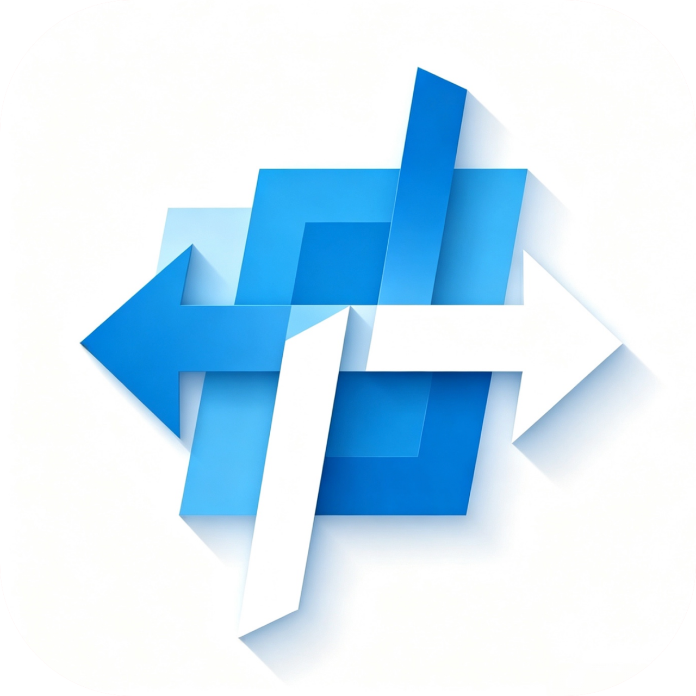
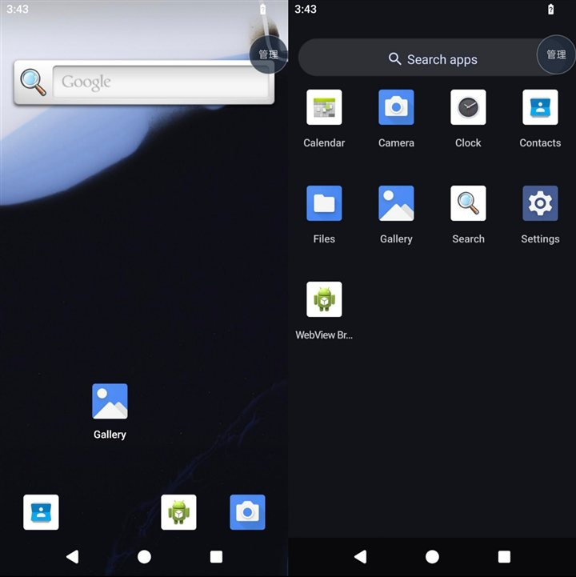

<p align="center">
  <picture>
    <source media="(prefers-color-scheme: dark)" srcset="assets/logo-dark.png">
    
  </picture>
</p>

<p align="center">
  <a href="LICENSES/AGPL-3.0-only.txt"></a>
  <a href="LICENSES/MIT.txt"></a>
  <a href="https://hub.docker.com/r/redroid/redroid"></a>
</p>

# guest-runtime-a15

这是一个可以在不用 root，不用 Docker，不用容器的情况下，让 **Android 15（API 35，arm64-only）** 运行在 VerseBox 虚拟机的安卓15独立客体😋

> **目前的状态：可以启动并操作。**
> 触摸可用，开机动画由客体自己的 `bootanimation.zip` 绘制。
> **wifi，音频，相机，传感器爆炸（但wifi的宿主网络注入已修复）这些问题会在后续修复。**
> overlay/idmap2d 与 networkstack 健康检查尚未处理，详见 [STATUS.md](STATUS.md)。



## 这是干什么的

Android 15 的镜像通常依赖容器或 root 环境运行。本仓库自行搭建运行所需的基础设施：
一份 API 35 的 linker/libc/libdl/libm，一套将客体绝对路径映射到 App 私有目录的补丁，
以及 Binder、属性、图形三座桥。用户空间复用 Redroid 15（ART、framework、系统应用、HAL），
构成一个不依赖宿主系统版本、也不需要特权的客体。

## 构建

**Windows：**

```bat
scripts\build-a15.cmd
```

**Linux / macOS：**

```sh
sh scripts/build.sh
```

脚本会按需跳过已完成阶段喵喵，顺序与产物验收见 [BUILD.md](BUILD.md)，ROM 文件产物位于 `prepared/` 
如需打包请在宿主工程中完成：`gradlew :app:assembleDebug`
（Gradle 等价入口：`gradlew :guest-runtime-a15:prepareA15Runtime`）。
需要 Python 3、JDK、Android SDK（`platforms/android-35`、`build-tools/35.0.0`），
重建桥接与图形还需要 NDK 29，路径通过 `ANDROID_HOME` 与 `ANDROID_NDK_HOME` 读取。

## 运行原理🤔

宿主 App 承担 init 的角色：读取清单，按 uid/gid 启动每个客体进程。
客体内的 `/system`、`/data` 等绝对路径由自建 linker/libc 重定向到本地目录，
内核不会访问宿主系统的对应路径：

| 层 | 来自 | 职责 |
| --- | --- | --- |
| 启动器 | 宿主工程 `FrameworkSession` | 读取清单、启动进程、收集日志与就绪标记 |
| 运行时 | `runtime/` | API 35 的 linker/libc/libdl/libm，含路径映射与私有属性区补丁 |
| 桥接 | `bridges/` | 属性服务、Binder/hwbinder 传输、设备、guest 日志、`netd`/`dnsresolver` 端点 |
| 图形 | `third_party/graphics/`、`bridges/graphics/` | goldfish EGL/GLES、gralloc、HWC；帧经 GPU socket 交给宿主合成 |
| 用户空间 | Redroid 15 镜像 | ART、framework、系统服务、系统 APK、HAL |
| 汇总 | `prepared/` | 以上全部打包为 assets、jniLibs 与清单 |

画面与输入都是客体的：SurfaceFlinger 合成图层，宿主只做显示与触摸转发；
开机动画由镜像自带的 `/system/bin/bootanimation` 绘制，`sys.boot_completed=1` 后退出。

## 目录

```text
scripts/     镜像抓取/解包/APEX 展开、prepared、开机动画、图形源与 host 安装、build 入口
bootstrap/   A15Boot、A15Zygote、A15AppLaunch 等 Java 启动层
vendor/      framework/（A15BpfMaps 等框架补丁）与 native/（JNI 注册、HAL）
bridges/     属性/Binder/设备/日志/图形桥源码与构建脚本
runtime/     API 35 linker/libc/libdl/libm 的源列表、补丁、构建脚本
third_party/graphics/  图形源：container 补丁与脚本、A9 生成物与 HAL 头
prebuilt/    pinned 的 desktop-gpu-host（宿主 GPU 端点）
bootanim/    开机动画素材
prepared/    产物：assets + jniLibs（不入库）
rootfs/      解包后的 Redroid 15 根文件系统（不入库）
```

> Java 层不在 `src/` 下（那里只有 `AndroidManifest.xml`）：启动类在
> `bootstrap/io/a10vm/guest/`，框架与检查类在 `vendor/framework/`，
> 两者由 `scripts/prepare-a15.py` 编进 `framework-check.dex`。

## 注意事项

- **镜像文件不在本仓库。** Redroid 15 的 tar 由 `scripts/fetch-redroid15.py` 构建时获取，
  仓库只包含构建它的补丁与应用源码。

- **图形源分两部分。** `third_party/graphics/` 里的补丁、生成物与 HAL 头随仓库分发；
  被固定的 goldfish/qemu 源码（255 个文件，6.2 MB）**随仓库提交**，
`scripts/fetch-graphics-sources.sh` 只作为被裁剪 checkout 的补救。

- **`prebuilt/arm64/desktop-gpu-host` 是 pinned 的宿主 GPU 端点**（附 sha256）。
  默认直接用；`sh scripts/build-desktop-host.sh` 可以只用本仓库源码重编
  （NDK 29 + `fetch-graphics-sources.sh`，不需要 A10 流水线）。

- **判定依据为来源与哈希，而非文件名**：清单中每条 native 均记录 `source` 与
  `sha256`，`verifyRuntimeA15` 在构建时逐条核对。

## 文档

- 构建、产物验收、排查：[BUILD.md](BUILD.md)
- 分阶段状态：[STATUS.md](STATUS.md)

## 许可证

本仓库按目录拆分许可：

- **核心客体运行时**（`runtime/`、`bridges/`、`bootstrap/`、`native/`、
  `third_party/graphics/container/`、`third_party/graphics/a9/patches/`、
  `prebuilt/arm64/desktop-gpu-host`）：**AGPL-3.0-only**
  （[全文](LICENSES/AGPL-3.0-only.txt)）。
  对外提供修改后的客体时，需按 AGPL §13 向使用者提供对应源码；
  个人自用、自行修改不受影响。

- **构建与集成工具**（`scripts/`、清单生成、宿主侧接入的配置与示例）：
  **MIT**（[全文](LICENSES/MIT.txt)）。可自由接入自有应用。

- **`vendor/`、`third_party/graphics/a9/{generated,definitions,framework}/`**：
  来自 AOSP 与宿主工程的共享容器层，保留 **Apache-2.0** 及文件自带的 BSD/MIT 声明，
  作为独立部分分发（含 `a9/upstream` 的 pinned goldfish/qemu 源码）。

Redroid 15 镜像在构建时获取，不随仓库分发，镜像自身许可以上游为准。
根目录 [LICENSE](LICENSE) 仅为拆分范围的简短说明。
